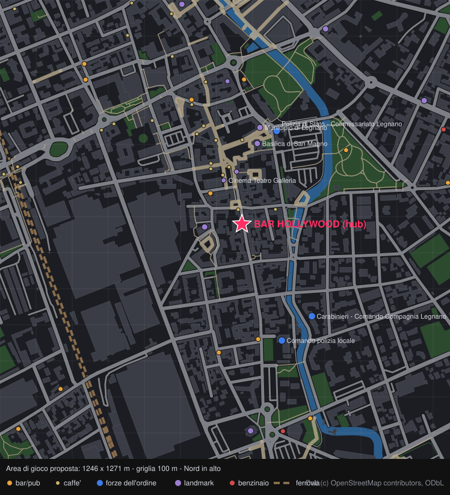

# GTA HOLLYWOOD — Concept v0.1

> Bozza da discutere insieme. Niente è definitivo: le sezioni segnate con **❓** sono domande aperte per te.

---

## 0. Premessa: "La Bocca del Paese"

Hai chiesto di partire da quanto imparato con **La Bocca del Paese**, ma in questa sessione ho accesso solo al repository `GTA-HOLLYWOOD-`, che è vuoto. Non ho quindi visto né il codice né le note di quel progetto.

Il concept qui sotto si basa su principi generali. **❓** Per allinearlo davvero mi serve una di queste cose:
- collegare il repo de *La Bocca del Paese* a questa sessione, oppure
- un elenco veloce di cosa ha funzionato e cosa no (stack, pipeline mappe, gestione NPC, problemi di prestazioni, cosa rifaresti diversamente).

---

## 1. Pitch

**Legnano, oggi. Un bar in Corso Magenta. Un paese da prendersi isolato per isolato.**

Sandbox criminale a vista dall'alto. Fuori è GTA 1/2: strade vere di Legnano ricostruite da OpenStreetMap, auto da rubare, sbirri alle calcagna. Dentro è Hotline Miami: irruzioni negli interni, si muore con un colpo, si riprova subito. Il **Bar Hollywood** è casa, quartier generale e cuore narrativo. Contro di te ci sono bande rivali, ognuna con il suo bar, e una guerra per il territorio che va avanti anche quando non guardi.

## 2. Pilastri di design

1. **Il paese è vero.** La pianta di Legnano viene dai dati OSM: chi ci vive deve riconoscere le strade. Il realismo sta nella geografia, il tono è sopra le righe.
2. **Due ritmi, un solo mondo.** Fuori si esplora, si improvvisa, si scappa. Dentro tutto è preciso e brutale e si ripete finché non viene perfetto.
3. **Il bar è vivo.** Gli avventori hanno routine, l'Hollywood si riempie e si svuota con l'ora del giorno. È il posto in cui torni, non un menu.
4. **Il territorio si muove.** Le zone cambiano padrone, le bande reagiscono, la mappa racconta chi comanda.
5. **Partite brevi e leggibili.** Una missione o una scorribanda deve stare in 5-15 minuti.

## 3. Ambientazione: il centro di Legnano



*Anteprima generata con `tools/osm_preview.py` da dati © OpenStreetMap contributors (ODbL).*

### 3.1 Area di gioco proposta
- **Bounding box:** lon 8.9100 → 8.9260, lat 45.5870 → 45.5985
- **Dimensioni:** circa **1,25 × 1,27 km**, intorno a 1,6 km²
- **Contenuto OSM nell'area di download:** circa 1.050 edifici, 147 strade con nome, il fiume Olona, la ferrovia Domodossola–Milano, parchi e piazze.
- **Hub:** Bar **Hollywood**, Corso Magenta 44 (nodo OSM `5875317518`, taggato `amenity=pub`). Si trova sul tratto pedonale di Corso Magenta, circa 200 m a sud di Piazza San Magno.

Per un open world in stile GTA 1/2 è una misura sensata: si attraversa in auto in circa un minuto e a piedi in 10-15. È piccola ma densa.

### 3.2 Confini naturali
- **Ovest:** la ferrovia e la stazione. È un muro naturale, si passa solo dai sottopassi (c'è anche il *Sottopasso Luigi Accorsi*).
- **Est:** l'Olona e i parchi lungo il fiume, poi il quartiere residenziale fino al bordo della mappa.
- **Nord e sud:** bordi "morbidi", chiusi in modo credibile con cantieri, transenne, posti di blocco e strade a fondo cieco.
- **Espansioni future:** a sud il Cimitero Monumentale e Piazza Mercato allargata, a sud-ovest lo Stadio Giovanni Mari, a nord il resto dell'asse del Sempione.

### 3.3 Distretti (proposta di gioco, ricavata dalla mappa)

| Distretto | Cosa c'è davvero (OSM) | Ruolo nel gioco |
|---|---|---|
| **Corso Magenta / Hollywood** | Hub, tratto pedonale, Piazza Carroccio a 130 m | Casa base, zona sicura (all'inizio) |
| **Centro storico / San Magno** | Basilica di San Magno, Municipio, Cinema Teatro Galleria, vie pedonali, Corso Garibaldi | Zona a traffico limitato: tanti passanti, **Commissariato di Polizia a circa 280 m**, rischio alto |
| **Ex Manifattura / zona industriale** | Ex Manifattura di Legnano, grandi capannoni industriali a ovest e sud-ovest | Magazzini, traffici, interni in stile HM perfetti |
| **Stazione e ferrovia** | Stazione di Legnano, Bar Stazione, Piazza Monumento con il Guerriero | Territorio di confine, spaccio, fughe in treno (futuro) |
| **Lungo Olona** | Fiume, Giardino Donatori del sangue, Parco Falcone-Borsellino, parcheggio di Via Gilardelli | Scorciatoie, nascondigli, incontri notturni |
| **Sud / Piazza Mercato** | Comando Polizia Locale, Piazza Mercato | Mercato di giorno, terra di nessuno di notte |
| **Est residenziale** | Centro sportivo Pino Cozzi, piscina comunale, Liceo Galilei | Quartiere "tranquillo", zona da conquistare |
| **Nord / Gallerie Cantoni** | Centro commerciale Gallerie Cantoni, Torre Colombera | Commercio, racket ai negozi |

### 3.4 Nota importante su nomi reali
OSM elenca molti bar reali nella zona. **Proposta: le bande rivali usano bar con nomi inventati**, posizionati nei lotti veri o in edifici generici. Associare a un clan criminale un locale esistente (e i suoi gestori) può creare problemi legali e di reputazione, soprattutto se il gioco gira in paese. Per lo stesso motivo conviene chiedere un via libera ai gestori dell'Hollywood prima di qualsiasi pubblicazione. **❓** Hai già un rapporto con loro?

---

## 4. Dati OpenStreetMap → mappa di gioco

### 4.1 Pipeline
```
OSM (API / estratto .osm)
   │  tools/osm_import
   ▼
Normalizzazione (proiezione in metri, ritaglio sulla bbox, pulizia)
   │
   ├─ Strati di terreno → griglia di tile (asfalto, marciapiede, pavé pedonale, erba, acqua, binari)
   ├─ Edifici → blocchi solidi con altezza (building:levels, default 3) → tetti in pseudo-3D stile GTA2
   ├─ Grafo stradale auto → corsie, sensi unici (oneway), incroci, semafori
   ├─ Grafo pedonale → marciapiedi (generati ai lati delle strade), footway, piazze, strisce
   └─ POI → spawn point (bar = locali/roccaforti, polizia = caserme, benzinai = esplosivi, chiese/piazze = landmark)
   │
   ▼
Override manuali (Tiled): dettagli che OSM non ha (dehors, cassonetti, auto parcheggiate, ingressi, interni)
   │
   ▼
Mappa di gioco a chunk (JSON + atlas)
```

### 4.2 Scala
- **1 m = 16 px** a zoom 1. Un personaggio è alto circa 24-28 px vista dall'alto, coerente con Hotline Miami.
- **Tile esterni da 2 m (32 px):** la mappa è di circa 625 × 635 tile, caricata a chunk da 32×32 tile.
- **Interni su griglia da 1 m (16 px)**, per avere precisione da HM su porte, coperture e linee di tiro.
- **Camera dinamica:** si allarga con la velocità in auto (come GTA 1/2) e si stringe a piedi o al chiuso.

### 4.3 Licenza
I dati OSM sono ODbL: va messa l'attribuzione nei crediti e nel gioco. Se si ridistribuisce il *database* derivato (non il gioco in sé) si applica la condivisione allo stesso modo. Il codice della pipeline va nel repo, così la mappa si rigenera quando OSM si aggiorna.

---

## 5. Gameplay

### 5.1 Modalità OPEN WORLD (stile GTA 1/2)
- Visuale dall'alto, movimento libero a piedi (8 direzioni + mira) e in auto (controlli arcade, derapate).
- **Auto:** si rubano, si guidano e si distruggono. Traffico generato sul grafo stradale reale, sensi unici inclusi.
- **Armi:** corpo a corpo (mazza, bottiglia, coltello) e da fuoco, con munizioni limitate.
- **Livello di ricercato a 4 gradini**, con sapore locale:
  1. **Polizia Locale**: vigili, multe, inseguimenti a piedi
  2. **Polizia di Stato**: volanti, posti di blocco
  3. **Carabinieri**: blocchi stradali, unità armate
  4. **Reparti speciali**: elicottero, assalto
  > Le tre caserme reali nell'area (Commissariato, Comando Compagnia Carabinieri, Comando Polizia Locale) diventano i punti di spawn.
- **Contatti per strada:** i passanti reagiscono (fuga, chiamata alla polizia, rissa) e ricordano per poco tempo.

### 5.2 Modalità INDOOR (stile Hotline Miami)
- **Si entra da porte specifiche:** bar rivali, magazzini, appartamenti, retrobottega. Dissolvenza e poi scena interna dedicata.
- Si muore con un colpo, sia tu sia i nemici. **Restart istantaneo** dal piano o dalla stanza.
- IA nemica a pattuglie e coni visivi, reazione al rumore (gli spari si sentono, la mazza no).
- Punteggio a fine livello: tempo, combo, stile, armi usate. Serve a rigiocare e sbloccare cose.
- **Esito → mondo:** svuotare il bar di una banda la indebolisce e fa cambiare colore alla zona.
- **❓** Elemento identitario simile alle maschere di HM? Per esempio sciarpe, cappellini o giacche con bonus, oppure "pose" del personaggio. Da decidere con te.

### 5.3 Ciclo di gioco
```
Hollywood (soldi, armi, voci di bancone)
   → esci in città: racket, furti, scorribande, scontri
       → irruzione indoor in un covo/bar rivale
           → cambia il controllo del territorio
               → le bande rispondono (attacchi, agguati, assalti all'Hollywood)
                   → torni all'Hollywood
```

---

## 6. Fazioni e territorio

- **La tua banda:** il giro dell'Hollywood. Membri e storie li introduci tu.
- **Bande rivali:** ognuna ha **un bar roccaforte** (nome inventato), un distretto di partenza, uno stile (armi, auto, colori) e un comportamento (aggressiva, commerciale, sfuggente). **❓** Quante e quali? Proposta di partenza: 3 rivali, ovest/stazione, nord/centro, sud/mercato.
- **Controllo delle zone:**
  - la mappa è divisa in **zone** (gruppi di isolati, ricavati dai poligoni stradali di OSM);
  - ogni zona ha una % di influenza per banda; la presenza di membri, il racket pagato e gli scontri vinti la spostano;
  - sopra una soglia la zona "è tua": rendita, spacciatori/esattori tuoi, meno ostilità;
  - le bande IA fanno guerra tra loro anche senza di te (simulazione astratta fuori schermo, scontri reali quando sei vicino).
- **Roccaforti:** si prendono solo con una missione indoor. Prendere il bar di una banda la elimina o la fa ritirare.

---

## 7. Hub: Bar Hollywood

- **Interno in stile HM ma pacifico:** niente armi estratte, salvo eventi scriptati come un'irruzione rivale.
- **Funzioni:** salvataggio, cassa (soldi del racket), deposito armi nel retro, bancone (voci e soffiate da cui nascono le missioni), juke-box (radio), telefono.
- **Spazi:** bancone con sgabelli, tavolini interni, bagno, retro/magazzino, **dehors su Corso Magenta**. Il bar si apre sulla strada pedonale ed è la transizione naturale tra interno ed esterno.
- **❓** Hai foto o una pianta dell'interno vero? La disposizione di bancone e tavoli rende il bar riconoscibile.

---

## 8. Personaggi non giocanti (scope del primo prototipo)

### 8.1 Passanti
- **Spawn a ciambella** intorno al giocatore (fuori dallo schermo, entro circa 150 m) e despawn quando sono lontani: popolazione costante e prestazioni stabili.
- **Densità per distretto e orario:** centro pedonale pieno di giorno e all'aperitivo, zona industriale quasi vuota, stazione con picchi agli orari dei treni.
- **Navigazione:** grafo pedonale da OSM (marciapiedi, piazze, footway), attraversano sulle strisce (quasi sempre).
- **Stati:** `cammina → si ferma (vetrina, telefono, chiacchiera in gruppo) → reagisce (paura/fuga, curiosità, rissa) → chiama la polizia`.
- **Varietà:** 6-8 archetipi visivi (studente, pensionato, operaio, signora con la spesa, ragazzi in monopattino…), colori casuali.

### 8.2 Avventori dell'Hollywood
- **Slot fisici** nel bar: sgabelli, tavoli, dehors, posto in piedi, bagno.
- **Routine:** `arriva → ordina al bancone → occupa uno slot → (beve / chiacchiera / gioca a carte / fuma fuori) → paga → esce`.
- **Affluenza** legata a un **ciclo giorno/notte**: caffè la mattina, deserto il primo pomeriggio, aperitivo pieno, notte con i "fedelissimi".
- **Due tipi:**
  - **occasionali:** generati, anonimi;
  - **abituali:** slot riservati per i personaggi che introdurrai tu (dialoghi, missioni).
- **Reazioni:** se entri armato o succede un casino, scappano o si nascondono sotto i tavoli.

### 8.3 Fuori dal primo prototipo (arrivano dopo da te)
Dialoghi, missioni, personaggi principali e storia.

---

## 9. Stile visivo e audio

- **Pixel art dall'alto** con edifici in **pseudo-3D (stile GTA2)**: i tetti sono "estrusi" verso la camera in base all'altezza OSM, così Legnano ha volume.
- **Due palette:** giorno lombardo (grigi caldi, cotto, verde dei parchi) e **notte neon** stile HM, che è il momento dell'Hollywood.
- **Interni:** palette satura e contrasti forti, pavimenti a scacchi, sangue leggibile (con un'opzione per ridurlo).
- **Audio:** synthwave/italo-disco per gli interni, radio in auto con stazioni parodia locali e ambiente cittadino (campane di San Magno, treni, motorini).

## 10. Controlli

- **PC:** WASD + mouse (mira/sparo), E per interagire ed entrare in auto, Spazio per correre o il freno a mano.
- **Gamepad:** twin-stick.
- **❓ Mobile/touch:** vuoi giocarlo anche da telefono? Cambia parecchio l'interfaccia (doppio stick virtuale) e il budget di prestazioni.

## 11. Tecnologia (proposta)

**Raccomandazione: TypeScript + Phaser 3 + Vite, gira nel browser.**
- Si gioca da un link, desktop e mobile, senza installare nulla. È facile da far provare agli amici del bar.
- Posso costruirlo, testarlo e farci screenshot automatici (Playwright) direttamente in queste sessioni cloud.
- Phaser gestisce tilemap a chunk, fisica arcade e tool come **Tiled** per gli interni.
- **Pipeline OSM** in Node/TypeScript o Python, eseguita in fase di build.

*Alternativa:* **Godot 4**. È più potente per illuminazione e IA, esporta su web e mobile, ma è meno comodo da sviluppare e verificare da remoto.

**❓** Che stack usava *La Bocca del Paese*? Se ha funzionato, ripartire da lì riduce i rischi.

---

## 12. Roadmap del primo prototipo ("concept movimenti")

| Milestone | Contenuto | Risultato verificabile |
|---|---|---|
| **M0 – Mappa** | Pipeline OSM → tilemap del centro, edifici solidi, camera libera | Si vola sopra Legnano e si riconoscono le strade |
| **M1 – Movimento** | Giocatore a piedi, collisioni con gli edifici, camera dinamica, mira | Si cammina da Piazza San Magno all'Hollywood |
| **M2 – Passanti** | Spawn a ciambella, grafo pedonale, stati base, fuga | Corso Magenta è popolato e reagisce |
| **M3 – Hollywood** | Interno del bar, transizione dentro/fuori, avventori con routine, ciclo giorno/notte | Si entra, il bar si riempie all'aperitivo |
| **M4 – Auto (opz.)** | Traffico sul grafo stradale, furto e guida | Si ruba un'auto in Corso Italia |
| **M5 – Indoor test (opz.)** | Una stanza HM di prova con 3 nemici e restart | Si sente il ritmo HM |

Dialoghi, missioni e personaggi restano fuori finché non li definisci tu.

---

## 13. Domande aperte (da qui ripartiamo insieme)

1. **La Bocca del Paese:** puoi collegare il repo o riassumere le lezioni chiave (stack, cosa ha funzionato, cosa no)?
2. **Piattaforma:** solo PC/browser, o anche mobile?
3. **Stack:** va bene Phaser/TypeScript nel browser, oppure preferisci Godot o quello usato in passato?
4. **Area di gioco:** la bbox proposta va bene? La allarghiamo (stadio, cimitero, Sempione)?
5. **Tono:** più parodia o commedia nera (GTA 1/2), o più crudo e onirico (Hotline Miami)? Che livello di violenza?
6. **Bande rivali:** quante, che stile, che nomi (inventati)?
7. **Hollywood:** hai foto o una pianta dell'interno? I gestori sono d'accordo a comparire?
8. **Protagonista:** personaggio fisso o personalizzabile?
9. **Elemento identitario indoor** (come le maschere di HM): ti piace l'idea? Che oggetto?
10. **Grafica:** pixel art da fare a mano, asset pack di partenza, o placeholder geometrici per il prototipo?
